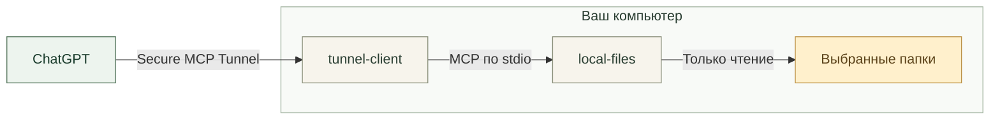

<div align="center">


# Strigov Local MCP

### Ваши файлы. Ваш выбор. Только чтение.

Подключите выбранные папки на компьютере к ChatGPT.<br>
Ищите документы, читайте заметки и находите нужное в проектах прямо в разговоре.

**macOS · Windows · Rust · Read-only MCP**

**[Скачать приложение →](https://github.com/strigov/GPT-MCP-filesystem/releases)**

[Установка](#установка) ·
[Подключение к ChatGPT](#подключение-к-chatgpt) ·
[Как это работает](#как-это-работает) ·
[Безопасность](#безопасность) ·
[Сборка](#сборка-из-исходников)

</div>

> [!NOTE]
> **Статус: pre-release.** Сборки не подписаны сертификатом издателя
> (macOS: ad-hoc подпись без нотариализации; Windows: без подписи), поэтому
> система может показать предупреждение при первом запуске. Подробности — в
> разделе [Ограничения](#ограничения-и-статус).

## Возможности

Нативное приложение в строке меню macOS и области уведомлений Windows. Без Docker, Node.js и WebView; туннельный клиент входит в дистрибутив.

| 📁 Вы выбираете папки | 👁 Только чтение | 🔗 Частное подключение |
|---|---|---|
| Изначально доступных папок нет. Добавляйте нужные и задавайте понятные прозвища — русский текст и пробелы поддерживаются. | MCP-инструментов записи, удаления, выполнения команд и сетевых запросов нет. | [OpenAI Secure MCP Tunnel](https://developers.openai.com/api/docs/guides/secure-mcp-tunnels): локальный HTTP-порт не открывается, ngrok и Cloudflare Tunnel не нужны. |

| 🔑 Ключ в системном хранилище | 📦 Дистрибутив без личных данных | ↩ Обновление с резервной копией |
|---|---|---|
| macOS Keychain или Windows Credential Manager. В JSON, журналах и командной строке ключа нет. | В установщике нет папок, ключей, профиля туннеля и привязки к аккаунту. | Настройки сохраняются, прежняя версия переносится в соседнюю папку `Strigov Local MCP backup …`. |

Всё управление — в меню значка серверной стойки: папки, подключение, статус и журнал. Перечёркнутый значок означает, что связь с OpenAI не подтверждена; причина показана в меню.

### Что можно спросить

После подключения папок попробуйте в разговоре с ChatGPT:

> «Покажи, какие папки тебе доступны».

> «Найди в подключённых папках текстовые файлы с упоминанием “релиз”».

> «Прочитай README проекта и кратко объясни, как его запустить».

Доступны только выбранные папки. Для PDF, DOCX и сканов понадобятся текстовые копии — подробнее в разделе [Инструменты MCP](#инструменты-mcp).

## Установка

Файлы скачиваются со страницы [Releases](https://github.com/strigov/GPT-MCP-filesystem/releases). Сейчас выпуски помечены как pre-release, поэтому ссылка «latest» GitHub их не показывает — выбирайте нужную версию в списке. Примеры ниже используют `<версия>` вместо номера.

| | macOS | Windows |
|---|---|---|
| **Система** | macOS 13+, Apple Silicon (arm64) | Windows 10/11 x64 |
| **Файл** | `Strigov-Local-MCP-<версия>-macos-arm64.dmg` | `Strigov-Local-MCP-<версия>-windows-x64.zip` |
| **Запуск** | Откройте образ и запустите **Install Strigov Local MCP.app** | Распакуйте **весь** архив и запустите `local-files-installer.exe` |
| **Куда ставится** | `~/Applications` | `%LOCALAPPDATA%\Programs\Strigov Local MCP` (права администратора не нужны) |
| **Автозапуск** | Запуск при входе | Туннель стартует задачей планировщика «Local Files Tunnel» при входе; значок в трее отдельно в автозагрузку не добавляется |
| **Настройки** | `~/Library/Application Support/Local Files` | `%LOCALAPPDATA%\Local Files` |
| **Ключ** | macOS Keychain | Windows Credential Manager |
| **Подпись** | ad-hoc, без Developer ID и нотариализации | не подписано, SmartScreen может предупредить |

Для пользователя не нужны Rust, Python, Node.js, Docker и Homebrew. Рядом с каждым архивом в релизе лежит файл `.sha256` и отчёт `.verification.json`.

<details>
<summary>Подробности установки и обновления</summary>

**macOS.** Установщик копирует приложение в `~/Applications`, добавляет запуск при входе и запускает значок в строке меню. Каталог настроек и системные идентификаторы сохранены с версий 2.x для совместимости, поэтому прежнее имя `Local Files` в путях — не ошибка. При обновлении с 2.1.0 прежний `Local Files.app` переносится в резервную копию и заменяется на `Strigov Local MCP.app`; повторно вводить ключ и выбирать папки не нужно. macOS может запросить доступ к выбранной папке.

**Windows.** Не запускайте установщик прямо из архива: рядом с ним должна лежать папка `payload`. Установщик проверяет SHA-256 всех файлов по `install-manifest.json` и отказывает, ничего не меняя, если приложение запущено или папка установки чужая. Перед обновлением остановите туннель (значок → «Остановить») и закройте значок («Закрыть значок»). Если SmartScreen показал «Windows защитила ваш компьютер», нажмите «Подробнее» → «Выполнить в любом случае» — только если архив получен из доверенного источника. Проверка целостности установщиком не заменяет подпись издателя.

Режим командной строки:

```powershell
local-files-installer.exe --check
local-files-installer.exe --install-to "C:\полный\путь" --no-launch
```

Инструкции, которые лежат внутри дистрибутивов: [macOS](docs/distribution-readme.txt), [Windows](docs/distribution-readme-windows.txt).

</details>

## Подключение к ChatGPT

1. Значок серверной стойки → **Подключённые папки** → **Добавить папку…**
2. **Подключение ChatGPT** → **Создать туннель в OpenAI Platform…** Создайте свой туннель и свяжите его с нужным workspace.
3. Создайте runtime API key с правами **Tunnels Read + Use**.
4. **Настроить или сменить подключение…** — введите tunnel ID и ключ. Перед применением приложение покажет выбранный туннель и список доступных ему папок.
5. После запуска туннеля добавьте в ChatGPT custom MCP server, выберите **Tunnel** и этот туннель. Workspace должен разрешать создание и использование таких подключений.

<details>
<summary><b>Управление папками, смена аккаунта и обновление подключения</b></summary>

- Приложение хранит **одно** подключение. Для другого компьютера создайте отдельный туннель и отдельный коннектор; для другого аккаунта или workspace на этом компьютере смените подключение через то же меню.
- **Отключить аккаунт…** останавливает туннель и удаляет его ключ; список папок сохраняется.
- Папки можно добавлять, заменять и отключать. Отключение прекращает доступ для новых MCP-вызовов (уже начатый запрос может завершиться), файлы остаются на месте. При замене папки назначается новый ID, чтобы прежние ссылки не указывали на другие документы.
- «Изменить прозвище…» — имя 1–64 символа, повторяющиеся имена запрещены; физическая папка не переименовывается. ChatGPT получает имя через `list_roots`, постоянный ID и ранее выданные ссылки сохраняются.
- После добавления папок или смены прозвищ коннектор обновлять не нужно: конфигурация перечитывается при каждом запросе. В старом разговоре попросите ChatGPT снова вызвать `list_roots`. Если вы обновляетесь со старой версии и сохранённая схема коннектора ограничивает корни именами `work` и `cowork`, один раз обновите инструменты коннектора.
- «Закрыть значок» закрывает только интерфейс, туннель продолжает работать; «Остановить» останавливает туннель.
- Secure MCP Tunnel предназначен для частных подключений. Распространение этого приложения не означает публикацию плагина в каталоге ChatGPT.

</details>

## Инструменты MCP

Все инструменты доступны только для чтения.

| Инструмент | Назначение |
|---|---|
| `list_roots` | Список подключённых папок и их доступность |
| `list_directory` | Содержимое каталога (глубина до 5, до 2000 элементов) |
| `get_file_info` | Размер, даты, MIME-тип, URI |
| `search_files` | Поиск по именам и путям без учёта регистра |
| `search_text` | Полнотекстовый поиск в текстовых файлах |
| `read_text_file` | Чтение текста целиком или по диапазону строк |
| `read_file` | Текст или ограниченный по размеру бинарный файл как MCP resource |
| `search`, `fetch` | Совместимый с ChatGPT интерфейс поиска и получения документов |

Поиск по всем папкам сразу задаётся значением `root=all`. Недоступные корни возвращаются в `unavailableRoots`, пропуски и достижение лимита сообщаются явно (`truncated`). OCR и конвертация документов в сервер не входят: для PDF, DOCX и сканов используйте локальные Markdown-копии (например, через AnyDoc, Docling или ocrmac), сохраняя оригиналы.

## Как это работает



Туннельный клиент входит в дистрибутив и запускает worker `local-files`. Значок Strigov Local MCP управляет настройками папок и подключения, показывает статус и диагностику.

<details>
<summary><b>Технические подробности</b></summary>

- Интерфейс построен на `tao`, `tray-icon` и `rfd`, большую часть времени «спит» до события. Диагностика выполняется раз в 5 секунд отдельным потоком без запуска shell.
- MCP-сервер написан на Rust (`rmcp`, однопоточный Tokio); одновременно выполняется одна дисковая операция.
- Закреплённая версия туннельного клиента и контрольные суммы — в [`scripts/tunnel-client.lock.json`](scripts/tunnel-client.lock.json).
- Приложение управляет только тем компьютером, на котором запущено. Объединение нескольких компьютеров за одним коннектором не реализовано.

</details>

## Безопасность

- **Доступ через `cap-std`.** Выход через `..`, абсолютные пути и внешние симлинки запрещён; поиск симлинки не обходит. Закрыты `.env*`, `.git`, `.ssh`, `.aws`, `node_modules` и приватные ключи.
- **Seatbelt на macOS.** Worker запускается через `sandbox-exec` с политикой, запрещающей запись файлов, сеть и создание дочерних процессов. Если `sandbox-exec` недоступен, worker не запускается.
- **Windows.** Песочницы уровня ОС, аналогичной Seatbelt, здесь нет: защита обеспечивается ограничениями на уровне кода (`cap-std`, список закрытых имён, только чтение) и очищенным окружением процесса worker.
- **Чистое окружение worker.** Worker стартует с явным минимальным набором переменных; ключ туннеля до него не доходит.
- **Атомарные настройки.** Некорректная конфигурация закрывает доступ (`CONFIG_UNAVAILABLE`), а не открывает его.
- **Лимиты.**
  - текстовый файл — до 5 МиБ, бинарный — до 15 МиБ;
  - текст ответа — до 200 000 Unicode-символов;
  - поиск — до 128 МиБ, 20 000 элементов и 10 секунд между файловыми операциями (ожидание внешнего диска или системного разрешения может занять больше); индекса в памяти нет.

## Ограничения и статус

- Релизы — pre-release. Подпись и нотариализация издателя отсутствуют.
- Выпускаются только macOS arm64 и Windows x64. Intel-сборка macOS пока не проверена и не выпущена; ARM64 и другие версии Windows не проверялись.
- macOS: минимальная версия 13 задана сборкой, отдельная машина с macOS 13 не тестировалась. Seatbelt (`sandbox-exec`) — устаревающий системный интерфейс, проверен на macOS 26.
- Windows: проверены установка, обновление, отказы, MCP через установленный worker и подключение реального аккаунта ChatGPT (вручную). Не проверены автоматизированные клики в трее и диалогах, срабатывание задачи «Local Files Tunnel» при следующем входе, восстановление после потери сети, SmartScreen на чистой машине. Удалённый CI на коде 2.1.2 не запускался. См. [отчёт проверки Windows](docs/windows-verification-2026-10-13.md).
- Готовность MCP не подтверждает, что система разрешила чтение каждого каталога (macOS может запросить доступ); проверьте конкретный документ после выдачи разрешения.
- Авторизация другого аккаунта ChatGPT требует его собственных данных и в проверку дистрибутива не входила.

## Сборка из исходников

Нужны только разработчику, пользователю — нет.

<details>
<summary><b>macOS</b> — Rust, Xcode Command Line Tools, Python 3 (и Node.js для тестового MCP-клиента)</summary>

```sh
sh scripts/build-installer.sh
python3 scripts/verify-distribution.py dist/Strigov-Local-MCP-<версия>-macos-arm64.dmg
```

`build-native.sh` определяет архитектуру текущего Mac, получает закреплённый по SHA-256 официальный runtime туннеля, убирает локальные пути из бинарников и собирает пакет по явному списку файлов. `build-installer.sh` создаёт DMG и файл `.sha256`. Для подписи задайте `LOCAL_FILES_SIGNING_IDENTITY`; нотариализация выполняется отдельно. Скрипт не читает рабочие профили туннеля и Keychain.

Проверка дистрибутива монтирует DMG, ставит приложение во временный каталог, проверяет пустые настройки, обновление с сохранением папок и резервной копией, подписи и отсутствие личных данных, затем запускает MCP-тесты через установленный Seatbelt worker. Результат записывается рядом в `.verification.json`. Рабочие службы и настройки пользователя не изменяются.

</details>

<details>
<summary><b>Windows x64</b> — Rust (MSVC), Python 3, Node.js 22 для тестов, PowerShell</summary>

```powershell
pwsh -NoProfile -File scripts/build-installer-windows.ps1
python -B scripts/verify-windows-distribution.py dist/Strigov-Local-MCP-<версия>-windows-x64.zip --output-root artifacts/windows-checks
```

Проверка ставит приложение из ZIP только в изолированные каталоги, проверяет обновление, отказы и MCP через установленный worker. Для MCP-тестов нужно право создавать symlink (режим разработчика Windows). Подробнее — [docs/windows-validation.md](docs/windows-validation.md).

</details>

Общие проверки кода:

```sh
cargo fmt --check
cargo clippy --locked --all-targets -- -D warnings
cargo test --locked
npm ci --ignore-scripts
npm run check
```

Сервер без GUI: `cargo build --release --locked --no-default-features --bin local-files`. Для изолированной проверки используйте абсолютный `LOCAL_FILES_DATA_DIR` или `--config /absolute/path/folders.json`.

Автоматические запуски CI при push и pull request отключены: [workflow](.github/workflows/native.yml) запускается только вручную (`workflow_dispatch`) на macOS и Windows.

## Структура репозитория

| Путь | Содержимое |
|---|---|
| `native/` | Rust-код: значок и меню, MCP-сервер, файловый слой, подключение, хранилище ключа, установщики |
| `scripts/` | Сборка и упаковка дистрибутивов, проверка, получение runtime туннеля |
| `test/` | Интеграционные тесты MCP (Node) и тест упаковки Windows |
| `docs/` | Инструкции внутри дистрибутивов, отчёты проверок, планы |
| `launchd/` | Шаблон LaunchAgent персональной установки (исторический) |
| `src/`, `Dockerfile` | Исходная Node.js/Docker-версия |

## Исторические материалы

- Исходная Node.js/Docker-версия сохранена в `src/` и `Dockerfile`; инструкции — в [docs/legacy-node.md](docs/legacy-node.md). Она рассчитана на две фиксированные папки `work` и `cowork` и не является частью нынешних дистрибутивов.
- Личные скрипты миграции и фонового запуска (`install-native.py`, `install-native-windows.ps1`, `*-background-service.sh`, `launchd/`) оставлены для истории: они привязаны к персональной установке автора, а `install-native.py` прямо отказывается устанавливать 2.1.
- Отчёты проверок: [значок и прозвища](docs/tray-nicknames-verification-2026-10-12.md), [дистрибутив macOS](docs/distribution-verification-2026-10-12.md), [Windows и установщик](docs/windows-verification-2026-10-13.md), [замеры Rust против Node](docs/native-verification.md).

## Лицензия

В `Cargo.toml` указана лицензия MIT. Отдельного файла `LICENSE` в репозитории нет.
