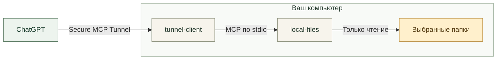

<div align="center">


# Strigov Local MCP

### Ваши файлы. Ваш выбор. Только чтение.

Подключите выбранные папки на компьютере к ChatGPT.<br>
Ищите документы, читайте заметки и находите нужное в проектах прямо в разговоре.

**macOS · Windows · Rust · Read-only MCP**

**[Скачать приложение →](https://github.com/strigov/GPT-MCP-filesystem/releases)**

[Установка](#установка) ·
[Подключение к ChatGPT](#подключение-к-chatgpt) ·
[Как это работает](#как-это-работает) ·
[Безопасность](#безопасность) ·
[Сборка](#сборка-из-исходников)

</div>

> [!NOTE]
> **Статус: pre-release.** Сборки не подписаны сертификатом издателя
> (macOS: ad-hoc подпись без нотариализации; Windows: без подписи), поэтому
> система может показать предупреждение при первом запуске. Подробности — в
> разделе [Ограничения](#ограничения-и-статус).

## Возможности

Нативное приложение в строке меню macOS и области уведомлений Windows. Без Docker, Node.js и WebView; туннельный клиент входит в дистрибутив.

| 📁 Вы выбираете папки | 👁 Только чтение | 🔗 Частное подключение |
|---|---|---|
| Изначально доступных папок нет. Добавляйте нужные и задавайте понятные прозвища — русский текст и пробелы поддерживаются. | MCP-инструментов записи, удаления, выполнения команд и сетевых запросов нет. | [OpenAI Secure MCP Tunnel](https://developers.openai.com/api/docs/guides/secure-mcp-tunnels): локальный HTTP-порт не открывается, ngrok и Cloudflare Tunnel не нужны. |

| 🔑 Ключ в системном хранилище | 📦 Дистрибутив без личных данных | ↩ Обновление с резервной копией |
|---|---|---|
| macOS Keychain или Windows Credential Manager. В JSON, журналах и командной строке ключа нет. | В установщике нет папок, ключей, профиля туннеля и привязки к аккаунту. | Настройки сохраняются, прежняя версия переносится в соседнюю папку `Strigov Local MCP backup …`. |

Всё управление — в меню значка серверной стойки: папки, подключение, статус и журнал. Перечёркнутый значок означает, что связь с OpenAI не подтверждена; причина показана в меню.

### Что можно спросить

После подключения папок попробуйте в разговоре с ChatGPT:

> «Покажи, какие папки тебе доступны».

> «Найди в подключённых папках текстовые файлы с упоминанием “релиз”».

> «Прочитай README проекта и кратко объясни, как его запустить».

Доступны только выбранные папки. Для PDF, DOCX и сканов понадобятся текстовые копии — подробнее в разделе [Инструменты MCP](#инструменты-mcp).

## Установка

Файлы скачиваются со страницы [Releases](https://github.com/strigov/GPT-MCP-filesystem/releases). Сейчас выпуски помечены как pre-release, поэтому ссылка «latest» GitHub их не показывает — выбирайте нужную версию в списке. Примеры ниже используют `<версия>` вместо номера.

| | macOS | Windows |
|---|---|---|
| **Система** | macOS 13+, Apple Silicon (arm64) | Windows 10/11 x64 |
| **Файл** | `Strigov-Local-MCP-<версия>-macos-arm64.dmg` | `Strigov-Local-MCP-<версия>-windows-x64.zip` |
| **Запуск** | Откройте образ и запустите **Install Strigov Local MCP.app** | Распакуйте **весь** архив и запустите `local-files-installer.exe` |
| **Куда ставится** | `~/Applications` | `%LOCALAPPDATA%\Programs\Strigov Local MCP` (права администратора не нужны) |
| **Автозапуск** | Запуск при входе | Туннель стартует задачей планировщика «Local Files Tunnel» при входе; значок в трее отдельно в автозагрузку не добавляется |
| **Настройки** | `~/Library/Application Support/Local Files` | `%LOCALAPPDATA%\Local Files` |
| **Ключ** | macOS Keychain | Windows Credential Manager |
| **Подпись** | ad-hoc, без Developer ID и нотариализации | не подписано, SmartScreen может предупредить |

Для пользователя не нужны Rust, Python, Node.js, Docker и Homebrew. Рядом с каждым архивом в релизе лежит файл `.sha256` и отчёт `.verification.json`.

<details>
<summary>Подробности установки и обновления</summary>

**macOS.** Установщик копирует приложение в `~/Applications`, добавляет запуск при входе и запускает значок в строке меню. Каталог настроек и системные идентификаторы сохранены с версий 2.x для совместимости, поэтому прежнее имя `Local Files` в путях — не ошибка. При обновлении с 2.1.0 прежний `Local Files.app` переносится в резервную копию и заменяется на `Strigov Local MCP.app`; повторно вводить ключ и выбирать папки не нужно. macOS может запросить доступ к выбранной папке.

**Windows.** Не запускайте установщик прямо из архива: рядом с ним должна лежать папка `payload`. Установщик проверяет SHA-256 всех файлов по `install-manifest.json` и отказывает, ничего не меняя, если приложение запущено или папка установки чужая. Перед обновлением остановите туннель (значок → «Остановить») и закройте значок («Закрыть значок»). Если SmartScreen показал «Windows защитила ваш компьютер», нажмите «Подробнее» → «Выполнить в любом случае» — только если архив получен из доверенного источника. Проверка целостности установщиком не заменяет подпись издателя.

Режим командной строки:

```powershell
local-files-installer.exe --check
local-files-installer.exe --install-to "C:\полный\путь" --no-launch
```

Инструкции, которые лежат внутри дистрибутивов: [macOS](docs/distribution-readme.txt), [Windows](docs/distribution-readme-windows.txt).

</details>

## Подключение к ChatGPT

1. Значок серверной стойки → **Подключённые папки** → **Добавить папку…**
2. **Подключение ChatGPT** → **Создать туннель в OpenAI Platform…** Создайте свой туннель и свяжите его с нужным workspace.
3. Создайте runtime API key с правами **Tunnels Read + Use**.
4. **Настроить или сменить подключение…** — введите tunnel ID и ключ. Перед применением приложение покажет выбранный туннель и список доступных ему папок.
5. После запуска туннеля добавьте в ChatGPT custom MCP server, выберите **Tunnel** и этот туннель. Workspace должен разрешать создание и использование таких подключений.

<details>
<summary><b>Управление папками, смена аккаунта и обновление подключения</b></summary>

- Приложение хранит **одно** подключение. Для другого компьютера создайте отдельный туннель и отдельный коннектор; для другого аккаунта или workspace на этом компьютере смените подключение через то же меню.
- **Отключить аккаунт…** останавливает туннель и удаляет его ключ; список папок сохраняется.
- Папки можно добавлять, заменять и отключать. Отключение прекращает доступ для новых MCP-вызовов (уже начатый запрос может завершиться), файлы остаются на месте. При замене папки назначается новый ID, чтобы прежние ссылки не указывали на другие документы.
- «Изменить прозвище…» — имя 1–64 символа, повторяющиеся имена запрещены; физическая папка не переименовывается. ChatGPT получает имя через `list_roots`, постоянный ID и ранее выданные ссылки сохраняются.
- После добавления папок или смены прозвищ коннектор обновлять не нужно: конфигурация перечитывается при каждом запросе. В старом разговоре попросите ChatGPT снова вызвать `list_roots`. Если вы обновляетесь со старой версии и сохранённая схема коннектора ограничивает корни именами `work` и `cowork`, один раз обновите инструменты коннектора.
- «Закрыть значок» закрывает только интерфейс, туннель продолжает работать; «Остановить» останавливает туннель.
- Secure MCP Tunnel предназначен для частных подключений. Распространение этого приложения не означает публикацию плагина в каталоге ChatGPT.

</details>

## Инструменты MCP

Все инструменты доступны только для чтения.

| Инструмент | Назначение |
|---|---|
| `list_roots` | Список подключённых папок и их доступность |
| `list_directory` | Содержимое каталога, ZIP и вложения EML/MSG в отсортированном прямом порядке (глубина до 5, до 2000 элементов); продолжение через `nextCursor` |
| `get_file_info` | Размер, даты, формат, MIME-тип, URI |
| `search_files` | Поиск по именам и путям без учёта регистра, продолжение через `nextCursor` |
| `search_text` | Поиск в UTF-8, PDF, DOCX, XLSX/XLS, EML/MSG; путь документа возвращает все совпадения с локаторами; продолжение через `nextCursor` |
| `read_text_file` | Чтение текста целиком или по диапазону строк |
| `inspect_document` | Структура PDF, DOCX, таблиц, писем и ZIP; размеры изображений и число страниц TIFF; для текста — размер и число строк |
| `read_document` | PDF со страницами, DOCX с абзацами и строками таблиц, XLSX/XLS с листами и строками, EML/MSG с частями письма; `startPage`/`endPage`, `sheet`, `maxChars` и `nextCursor` |
| `read_file` | Текст документов, ZIP-элементов и вложений через `::`; PNG/JPEG/GIF/WebP/TIFF/BMP и сканы PDF (`page`) как MCP image, увеличение через `region`; составные страницы PDF как одностраничный resource |
| `search`, `fetch` | Совместимый с ChatGPT интерфейс поиска и получения документов |

Поиск по всем папкам сразу задаётся значением `root=all`. Недоступные корни возвращаются в `unavailableRoots`, пропуски и достижение лимита сообщаются явно (`truncated`). Для полного охвата передавайте `nextCursor` в тот же инструмент с прежними параметрами последовательности; `limit` и `maxChars` можно менять. Порядок обхода: каталог, затем его потомки, имена отсортированы. Симлинки не обходятся. В `list_directory`, `search_files` и `search_text` поле `skippedTooDeep` считает записи, не перечисленные из-за слишком длинной позиции для курсора; содержимое пропущенного каталога не обходится и не учитывается в счётчике. Курсор документа после изменения файла возвращает `STALE_CURSOR`; начните чтение заново. Документный `nextCursor` от `read_file`, как и `metadata.nextCursor` от `fetch`, передаётся в `read_document`.

OCR и конвертация документов в сервер не входят. Создавать текстовые или Markdown-копии сканов своими инструментами пользователь может по своему выбору; оригиналы при этом остаются без изменений. PDF с текстовым слоем читаются напрямую: цитируйте логическое имя файла и страницу из заголовков; `ocr_layer` означает текст, ранее встроенный OCR-программой, и может содержать ошибки. `inspect_document` отмечает подозрительный текст, включая латиницу без кириллицы поверх скана. Сканы доступны через `read_file` с `page`: одиночные изображения JPEG, JBIG2, JPX и CCITT (G4/G3) извлекаются в MCP image. Составные страницы, страницы с видимыми аннотациями или обрезающим изображение clipping и ошибки декодирования используют одностраничный PDF fallback. Видимые штампы и подписи с appearance сохраняются в нём; действия аннотаций и дерево полей формы исключаются. Целый многостраничный PDF не возвращается. HEIC/HEIF требуют конвертации в JPEG/PNG; DOC/PPT/PPTX/ODT/ODS/RTF — сохранения в DOCX или PDF; RAR/7z — распаковки или ZIP. RTF больше не читается как обычный текст и не включается в `search_text`. `search_text` ищет также в PDF, DOCX, XLSX/XLS, EML и MSG с локаторами страниц, абзацев, строк или частей письма. В папке возвращается первое совпадение каждого файла; `root` и `path` одного документа возвращают все совпадения с курсором. В ZIP и вложения при обходе папки поиск не заходит; конкретный элемент можно искать по его `::` пути.

Поддерживаемые текстовые форматы:

| Формат | Содержимое и источник фрагмента |
|---|---|
| PDF | Текстовый/OCR-слой, номер страницы; обзор классифицирует страницы и отмечает подозрительный текст |
| DOCX/DOCM | Абзацы `¶N`, строки таблиц, вставки `{++…++}`, удаления `{--…--}`, комментарии `{==…==}[cN]` и раздел Comments с автором и датой; обзор показывает количество абзацев, таблиц, комментариев и правок |
| XLSX/XLSM, XLS | Кэшированные значения без пересчёта формул; имя листа, номер строки, обозначения столбцов и даты ISO; `sheet` выбирает один лист по имени или индексу с 1, обзор перечисляет листы и видимость |
| EML, MSG | Заголовки и абзацы тела; HTML преобразуется в текст; обзор содержит заголовки и список вложений с индексом, именем, типом и размером |
| UTF-8 текст | Строки с номерами |
| ZIP | Обзор и список элементов; CP866 и UTF-8 имена, вложенные контейнеры до трёх уровней `::`, чтение элементов всеми перечисленными модулями |

DOCX не восстанавливает автоматическую нумерацию списков и не извлекает колонтитулы, сноски или текстовые поля вне основного порядка. XLSX/XLS не передаёт форматирование, объединения, графики и изображения. Вложения писем открываются по индексу с 1: `письмо.eml::1` или `письмо.msg::2`; их формат определяется именем, а вложенное RFC 822 письмо читается как EML. MSG с телом только в сжатом RTF сообщает `body only in RTF`; встроенные Outlook-сообщения перечисляются без чтения. Зашифрованные Office-файлы не поддерживаются.

`list_directory` перечисляет ZIP и вложения писем. Путь `дело.zip::Папка/договор.docx` открывает элемент, `дело.zip::Папка` перечисляет префикс, `дело.zip::inner.zip::x.txt` читает вложенный архив. Глубина списка считает уровни `/` ниже префикса. `read_file`, `read_text_file`, `read_document`, `inspect_document` и `fetch` принимают такие пути. Небезопасные, зашифрованные и неподдерживаемые элементы помечаются `readable:false` с `reason`; закрытые имена скрыты и недоступны. Поддерживаются Stored и Deflated; распаковка выполняется только в память и никогда не записывает файлы. `search_files` ищет только файлы на диске.

Изображения автоматически ориентируются по EXIF и уменьшаются до длинной стороны 2048 px. `region: {x,y,width,height}` задаёт доли 0–1 уже ориентированного изображения для увеличения фрагмента; `page` выбирает страницу TIFF (с 1). `inspect_document` показывает размеры изображения и число страниц TIFF. У PDF без `page` по-прежнему читается текстовый слой; в заголовках и обзоре есть подсказка для просмотра страницы.

Ветка по эксперименту Ф1 — **A+pdf**: изображения приходят напрямую, одностраничный PDF служит редким fallback для страниц, чьё изображение нельзя извлечь. Для каждого embedded PDF resource ChatGPT спрашивает **Allow file materialization?**. Разрешения **Allow once** / **Always allow for this chat** действуют только в текущем чате; одобрите запрос, чтобы модель увидела страницу.

## Как это работает



Туннельный клиент входит в дистрибутив и запускает worker `local-files`. Значок Strigov Local MCP управляет настройками папок и подключения, показывает статус и диагностику.

<details>
<summary><b>Технические подробности</b></summary>

- Интерфейс построен на `tao`, `tray-icon` и `rfd`, большую часть времени «спит» до события. Диагностика выполняется раз в 5 секунд отдельным потоком без запуска shell.
- MCP-сервер написан на Rust (`rmcp`, однопоточный Tokio); одновременно выполняется одна дисковая операция.
- Закреплённая версия туннельного клиента и контрольные суммы — в [`scripts/tunnel-client.lock.json`](scripts/tunnel-client.lock.json).
- Приложение управляет только тем компьютером, на котором запущено. Объединение нескольких компьютеров за одним коннектором не реализовано.

</details>

## Безопасность

- **Доступ через `cap-std`.** Выход через `..`, абсолютные пути и внешние симлинки запрещён; поиск симлинки не обходит. Закрыты `.env*`, `.git`, `.ssh`, `.aws`, `node_modules` и приватные ключи.
- **Seatbelt на macOS.** Worker запускается через `sandbox-exec` с политикой, запрещающей запись файлов, сеть и создание дочерних процессов. Если `sandbox-exec` недоступен, worker не запускается.
- **Windows.** Песочницы уровня ОС, аналогичной Seatbelt, здесь нет: защита обеспечивается ограничениями на уровне кода (`cap-std`, список закрытых имён, только чтение) и очищенным окружением процесса worker.
- **Чистое окружение worker.** Worker стартует с явным минимальным набором переменных; ключ туннеля до него не доходит.
- **Атомарные настройки.** Некорректная конфигурация закрывает доступ (`CONFIG_UNAVAILABLE`), а не открывает его.
Лимиты источников и ответов разделены:

| На диске / при обработке | На один ответ / вызов |
|---|---|
| UTF-8 текст — до 64 МиБ, потоковая проверка всего файла | До 200 000 Unicode-символов; `read_document`/`fetch` по умолчанию 100 000 |
| PDF — до 512 МиБ; зашифрованный PDF — до 256 МиБ, пароль не поддерживается | Текст по страницам с курсором; обзор до 10 с с продолжением; распаковка потока до 64 МиБ |
| PNG/JPEG/GIF/WebP/TIFF/BMP — до 128 МиБ; декодирование до 256 МиБ | MCP image до 2048 px по длинной стороне и 1 494 174 байт; PNG либо JPEG с адаптацией качества/размера |
| Просмотр страницы PDF — до 512 МиБ исходного PDF; одна страница и одно декодируемое изображение за вызов | Изображение либо одностраничный PDF до 262 137 байт; иначе `OUTPUT_TOO_LARGE` |
| DOCX/DOCM — до 256 МиБ, XML-часть до 64 МиБ; встроенные медиа не читаются | Текст с курсором, комментариями и правками; обзор со счётчиками |
| XLSX/XLSM и XLS — до 64 МиБ; XLSX до 256 МиБ фактически распакованных XML, до 20 000 ZIP-записей, коэффициент до 200 для частей больше 1 МиБ | Диапазон до 4 000 000 ячеек и развёрнутый текст до 64 МиБ: на лист XLSX, суммарно на XLS; текст формул XLS входит в бюджет; shared strings до 64 МиБ / 48 записей; строки с курсором |
| EML — до 64 МиБ | Заголовки, тело, вложения через `::N` и курсор; koi8-r, cp1251, IBM866, ISO-8859-5 |
| MSG — до 256 МиБ | Заголовки, текст/HTML, вложения через `::N`; RTF-only и встроенные сообщения отмечаются явно |
| ZIP — до 20 000 элементов; элемент/вложение до 256 МиБ и не больше лимита собственного формата; коэффициент распаковки до 200 для элементов больше 1 МиБ | До трёх уровней `::`; списки с курсором; фактически прочитанный элемент не может превышать заявленный размер |
| Прочие бинарные файлы — до 15 МиБ | MCP resource |
| `search_text` в папке: до 5 МиБ на текстовый файл и до 64 МиБ на документ | До 128 МиБ текста + 512 МиБ источников документов, 20 000 записей и 10 с, затем курсор; минимум одна запись/единица за вызов. `documentsSearched` — число документов, открытых для поиска |
| Каталоги: окно сортировки до 100 000 имён, следующие окна перечитываются | Список до 2000 записей, поиск имён до 200 результатов, поиск текста до 100 результатов |

`maxChars` включает заголовки и разделители. При слишком малом бюджете документ возвращает обязательное оформление и один символ текста (либо пустую единицу), чтобы курсор продвигался; абсолютный предел 200 000 сохраняется. Курсоры ограничены 2048 байтами. Одновременно выполняется одна операция, не более двух блокирующих потоков; индекса и кэша нет. Ожидание внешнего диска или системного разрешения может превысить бюджет, проверяемый между записями/страницами. Имена сравниваются после `to_string_lossy`; редкие не-UTF-8 имена могут пропускаться или повторяться между курсорами.

Для визуальных PDF-потоков до запуска кодека проверяются размеры: CCITT/JBIG2 до 2^28 пикселей на страницу/регион; суммарно JBIG2 до 2^30 пикселей. На весь вызов JBIG2 (страница вместе с `JBIG2Globals`) допускается до 65 536 сегментов и до 2^20 ссылок на экспортированные символы; из одного сегмента — до 1024 ссылок на различные сегменты. Разрешены типы 0, 6/7, 38/39, 42/43, 48–52 и 62: словари символов, непосредственные текстовые/generic/refinement-регионы и служебные сегменты. Pattern dictionaries, halftone, промежуточные регионы, custom Huffman tables и неизвестные типы направляются в PDF fallback без вызова кодека. JPX ограничен 2^28 пикселями, 65 535 тайлами и четырьмя компонентами; разрешение снижается под лимит 256 МиБ (5 байт на сэмпл).

Обычный page view занимает примерно PDF плюс до 0,7 ГиБ. Заголовочные ограничения не охватывают содержимое символьных словарей JBIG2 и копии символов при повторном экспорте, а также внутренние структуры JPX; кодеки не имеют отмены по времени (остаточный риск R18 плана). Общий PDF load сохраняет остаточный риск R17. По принятой модели угроз DoS от специально сконструированных файлов остаётся допустимым остаточным риском; для обычных, повреждённых и обрезанных реальных файлов действуют заявленные ограничения. Конфиденциальность, целостность, доступ только внутри выбранных корней и режим чтения обязательны для любых файлов.

## Ограничения и статус

- Релизы — pre-release. Подпись и нотариализация издателя отсутствуют.
- Выпускаются только macOS arm64 и Windows x64. Intel-сборка macOS пока не проверена и не выпущена; ARM64 и другие версии Windows не проверялись.
- macOS: минимальная версия 13 задана сборкой, отдельная машина с macOS 13 не тестировалась. Seatbelt (`sandbox-exec`) — устаревающий системный интерфейс, проверен на macOS 26.
- Windows: проверены установка, обновление, отказы, MCP через установленный worker и подключение реального аккаунта ChatGPT (вручную). Не проверены автоматизированные клики в трее и диалогах, срабатывание задачи «Local Files Tunnel» при следующем входе, восстановление после потери сети, SmartScreen на чистой машине. Удалённый CI на коде 2.1.2 не запускался. См. [отчёт проверки Windows](docs/windows-verification-2026-10-13.md).
- Готовность MCP не подтверждает, что система разрешила чтение каждого каталога (macOS может запросить доступ); проверьте конкретный документ после выдачи разрешения.
- Авторизация другого аккаунта ChatGPT требует его собственных данных и в проверку дистрибутива не входила.

## Сборка из исходников

Нужны только разработчику, пользователю — нет.

<details>
<summary><b>macOS</b> — Rust, Xcode Command Line Tools, Python 3 (и Node.js для тестового MCP-клиента)</summary>

```sh
sh scripts/build-installer.sh
python3 scripts/verify-distribution.py dist/Strigov-Local-MCP-<версия>-macos-arm64.dmg
```

`build-native.sh` определяет архитектуру текущего Mac, получает закреплённый по SHA-256 официальный runtime туннеля, убирает локальные пути из бинарников и собирает пакет по явному списку файлов. `build-installer.sh` создаёт DMG и файл `.sha256`. Для подписи задайте `LOCAL_FILES_SIGNING_IDENTITY`; нотариализация выполняется отдельно. Скрипт не читает рабочие профили туннеля и Keychain.

Проверка дистрибутива монтирует DMG, ставит приложение во временный каталог, проверяет пустые настройки, обновление с сохранением папок и резервной копией, подписи и отсутствие личных данных, затем запускает MCP-тесты через установленный Seatbelt worker. Результат записывается рядом в `.verification.json`. Рабочие службы и настройки пользователя не изменяются.

</details>

<details>
<summary><b>Windows x64</b> — Rust (MSVC), Python 3, Node.js 22 для тестов, PowerShell</summary>

```powershell
pwsh -NoProfile -File scripts/build-installer-windows.ps1
python -B scripts/verify-windows-distribution.py dist/Strigov-Local-MCP-<версия>-windows-x64.zip --output-root artifacts/windows-checks
```

Проверка ставит приложение из ZIP только в изолированные каталоги, проверяет обновление, отказы и MCP через установленный worker. Для MCP-тестов нужно право создавать symlink (режим разработчика Windows). Подробнее — [docs/windows-validation.md](docs/windows-validation.md).

</details>

Общие проверки кода:

```sh
cargo fmt --check
cargo clippy --locked --all-targets -- -D warnings
cargo test --locked
npm ci --ignore-scripts
npm run check
```

Сервер без GUI: `cargo build --release --locked --no-default-features --bin local-files`. Для изолированной проверки используйте абсолютный `LOCAL_FILES_DATA_DIR` или `--config /absolute/path/folders.json`.

Автоматические запуски CI при push и pull request отключены: [workflow](.github/workflows/native.yml) запускается только вручную (`workflow_dispatch`) на macOS и Windows.

## Структура репозитория

| Путь | Содержимое |
|---|---|
| `native/` | Rust-код: значок и меню, MCP-сервер, файловый слой, подключение, хранилище ключа, установщики |
| `scripts/` | Сборка и упаковка дистрибутивов, проверка, получение runtime туннеля |
| `test/` | Интеграционные тесты MCP (Node) и тест упаковки Windows |
| `docs/` | Инструкции внутри дистрибутивов, отчёты проверок, планы |
| `launchd/` | Шаблон LaunchAgent персональной установки (исторический) |
| `src/`, `Dockerfile` | Исходная Node.js/Docker-версия |

## Исторические материалы

- Исходная Node.js/Docker-версия сохранена в `src/` и `Dockerfile`; инструкции — в [docs/legacy-node.md](docs/legacy-node.md). Она рассчитана на две фиксированные папки `work` и `cowork` и не является частью нынешних дистрибутивов.
- Личные скрипты миграции и фонового запуска (`install-native.py`, `install-native-windows.ps1`, `*-background-service.sh`, `launchd/`) оставлены для истории: они привязаны к персональной установке автора, а `install-native.py` прямо отказывается устанавливать 2.1.
- Отчёты проверок: [значок и прозвища](docs/tray-nicknames-verification-2026-10-12.md), [дистрибутив macOS](docs/distribution-verification-2026-10-12.md), [Windows и установщик](docs/windows-verification-2026-10-13.md), [замеры Rust против Node](docs/native-verification.md).

## Лицензия

В `Cargo.toml` указана лицензия MIT. Отдельного файла `LICENSE` в репозитории нет.
